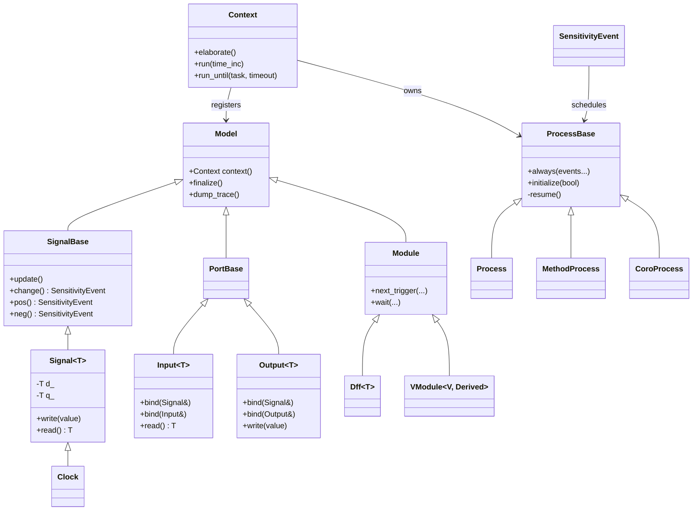

# dspsim Architecture Overview

`dspsim` is a C++ discrete-event (delta-cycle) simulation engine, exposed to Python via
nanobind, used to simulate hardware designs, either hand-written C++/Python models or
Verilator-generated models of Verilog/SystemVerilog RTL. This document describes how the core
pieces fit together. Related documents: [Coro.md](Coro.md) (coroutine processes and
awaitables), [BitSlicing.md](BitSlicing.md) (bit slicing and packing) and
[VerilatedPorts.md](VerilatedPorts.md) (the ports of verilated modules: wide and struct ports) and
[Vhdl.md](Vhdl.md) (VHDL models).

## Component map



## Core classes (`src/include/dspsim/`, sources in `src/`)

### `Model` ([model.h](../src/include/dspsim/model.h) / [model.cpp](../src/model.cpp))
Base class for everything that is part of a design (signals, ports, modules). On
construction it self-registers with the context under construction (`Context::obtain()`),
gets a unique id, and records the module being constructed as its parent, which gives it
a hierarchical name (`hier_name()`). It has two virtual hooks:
- `finalize()`: called once by `Context::elaborate()`, after the whole design is built.
- `dump_trace()`: called at the end of a delta cycle on models that requested tracing.

Models do not evaluate themselves. Evaluation belongs to processes, and committing values
belongs to signals (see below).

### `Context` ([context.h](../src/include/dspsim/context.h) / [context.cpp](../src/context.cpp))
Owns a simulation: the registered models, the processes, the delta-cycle scheduling
stacks (`process_eval_stack_`, `signal_update_stack_`, `post_update_stack_`,
`sensitivity_event_stack_`), and a time-ordered `time_event_stack_` for scheduled future
events (clock edges, time waits).

A global `ContextFactory` tracks the context under construction. `Context::create()`
takes a construction lock: another thread calling `create()` blocks until the context is
elaborated or `release()`d, and the same thread calling it again gets
`ContextConstructionError` (`Context::reset()` discards the active context).
`Context::obtain()` never creates a context. It throws unless the calling thread has one
under construction, so models can only be built between `create()` and `elaborate()`.

Key methods:
- `elaborate()`: calls `finalize()` on every registered model (this is what triggers lazy
  port-binding resolution, see below), locks the design, and releases the context from
  the global factory so a new, independent context can be created.
- `run(time_inc)`: runs delta cycles until nothing is left to evaluate or update (see
  [Delta-cycle execution model](#delta-cycle-execution-model)), then advances simulated
  time through the scheduled time events, settling the design at each time step.
  `run(0)` settles the design without advancing time. The delta-cycle loop itself,
  `eval()`, is private.
- Registering a process schedules it, so every process is evaluated once in the next
  delta cycle: at the start of the simulation, where it lets combinational logic settle
  from the initial signal values, or when the simulation continues if the process was
  registered later (between `run()` calls, or by a running process, which starts it in
  the same delta cycle). A process opts out with `initialize(false)`, which takes it
  off the evaluation stack and chains with `always(...)`.
- `run_until(task, timeout)` / `run_until(event, timeout)`: run the simulation until a
  coroutine task completes (returning its value) or an event triggers. See
  [Coro.md](Coro.md).

### `Signal<T>` ([signal.h](../src/include/dspsim/signal.h) / [signal.cpp](../src/signal.cpp))
Holds a committed value `q_` and a pending value `d_`. `SignalBase` owns three
`SensitivityEvent`s: `change()`, `pos()`, and `neg()`.
- `write(value)` sets `d_` and, if it differs from `q_`, pushes the signal onto the
  context's `signal_update_stack_`.
- `read()` returns `q_` (the last committed value).
- `update()` runs in the update phase. If the value actually changed, it notifies
  `pos()` or `neg()` (for a rising or falling value) and `change()`, then commits
  `d_` → `q_`.

A signal can also be sliced and packed (`sig[{hi, lo}]`, `pack(a, b)`). Signals derived
from such a selection are recomputed in a second pass of the update phase. See
[BitSlicing.md](BitSlicing.md).

`T` is any type that can be copied, compared with `==` and constructed without arguments. The numbers
(`uint8_t` to `int64_t`, `float`, `double`) are the types that the core library instantiates and that
Python knows. A model can use others, which are compiled with the model:

```cpp
struct Sample
{
    int16_t re = 0;
    int16_t im = 0;
    bool operator==(const Sample &) const = default;
};

dspsim::Input<Sample> in{"in"};       // also Output<Sample>, Signal<Sample>, SignalArray<Sample> ...
out.write({in.read().im, in.read().re});
```

With a struct (or a `std::array`, an enumeration, ...) as its value, a signal carries all the fields at
once: a write replaces the whole value, the signal is compared and committed once, and it has one change
event, whichever field changed. Its `pos()` and `neg()` never occur, and it cannot be sliced. This is the
fast way to pass a struct whose fields go in one direction (see the `structs` suite in
[Benchmarks.md](Benchmarks.md)): one signal instead of one per field. A `PortStruct` (below) is the other
way: a port and a signal per field, which can have different directions, be driven by different processes
and be waited for one by one. Such signals and ports are C++ only for now: they have no Python bindings.

`Signal<T>::write()` schedules the signal with `SignalBase::request_update()`, which is not inline: the
member functions of `Signal<T>` are in the header, for the types of models, and need nothing of the
scheduler that way.

### `SensitivityEvent` / `TimeEvent` ([event.h](../src/include/dspsim/event.h) / [event.cpp](../src/event.cpp))
A `SensitivityEvent` holds the processes that are sensitive to it, in two lists: static
subscribers (scheduled every time the event occurs) and dynamic subscribers (scheduled
once, on the next occurrence). The lists are allocated on first subscription, so an event
nobody subscribed to costs the signal that owns it a null check. Both lists and the first
subscribers of each (two static, one dynamic) share one cache line, see "Headers and inline
code" below; further subscribers go to an array on the heap.

An event is notified in one of two ways, and both queue it on the context's
`sensitivity_event_stack_`. Once all signals of the round have updated, the context calls
`trigger()` on each queued event, which pushes the subscribed processes onto
`process_eval_stack_`: they are evaluated in the next round, where `has_happened()` is true.
- A signal notifies its own events when it commits a new value in the update phase
  (`notify_committed()`, private). No process runs between then and `trigger()`, so the
  subscribers are known and an event without any is not queued.
- User code calls `notify()`, from a process or between two runs, to raise an event of its own
  (a module's `received()` event, for example). It always queues the event, and `trigger()` looks
  at the subscribers when the evaluation phase is over. A process that starts waiting on the event
  after the `notify()` call, later in the same evaluation phase, is therefore woken as well, and
  the result does not depend on which of the two processes ran first. This is SystemC's delta
  notification, `notify(SC_ZERO_TIME)`. An event that is notified between two runs starts a delta
  cycle in the next run.

A `TimeEvent` is a `{time, process, wake_count}` entry in the context's time-event queue.

### `Channel` ([channel.h](../src/include/dspsim/channel.h))
Base class for state of the user's own that is committed in the update phase, the way the value of a
signal is (SystemC: `sc_prim_channel`). A channel calls `request_update()` when a process has changed it,
and the context calls its `update()` once in the update phase of that delta cycle, after the signals have
committed. `update()` makes the change visible and usually notifies an event. Every process of a delta
cycle therefore sees the same state of the channel, whatever the order of evaluation, which a queue or a
mailbox that two processes share directly does not give. Channels and derived signals share one hook
(`detail::Updatable`) and one stack in the context, so a design without channels pays nothing for them.

`update()` may change the channel's own state and notify events. It must not write to a signal and must
not request the update of a channel, itself included: writes belong to the evaluation phase, and one
made in the update phase is not committed with the others of the delta cycle (a signal written there
changes one delta cycle late). The same holds for a class that overrides `SignalBase::update()`. The
engine does not check this: the check would have to sit in `Signal::write()`, on the path of every
write.

A channel can be written in Python as well:

```python
class Mailbox(Channel):
    def __init__(self, context):
        super().__init__(context)
        self.written = SensitivityEvent(context)
        self._value = self._next = 0

    def put(self, value):
        self._next = value
        self.request_update()

    def get(self):
        return self._value

    def update(self):  # called by the context in the update phase
        self._value = self._next
        self.written.notify()
```

The context keeps a Python channel, and an event that Python creates with `SensitivityEvent(context)`,
alive until it is cleared: the context and the processes refer to them, whether or not Python still does
(see "Ownership" below).

### Processes ([process.h](../src/include/dspsim/process.h), [coro.h](../src/include/dspsim/coro.h))
A process is the unit of evaluation. Modules register them in their constructor and the
context owns them:
- `DSPSIM_METHOD(eval)` registers a member function as a `MethodProcess`. The function is
  bound at compile time and called through a plain function pointer.
- `DSPSIM_CORO(task)` registers a C++20 coroutine (`Task<>`) as a `CoroProcess`.
- `Context::register_process_func()` registers any `std::function<void()>`.
- `Context::spawn(task)` starts a coroutine while the simulation runs and returns nothing: the context
  destroys the process when the task has completed (`ProcessBase::complete()` puts it on a list that
  `Context::eval()` empties once the delta cycles of the time step are over). Every other process lives
  as long as the context, so a `ProcessBase*` stays valid.

`process->disable()` stops a process from being evaluated until `enable()`: its static sensitivity is
ignored, what it asked for with `next_trigger()` is dropped, and it leaves the evaluation stack. It is
meant for method processes. A coroutine can only be disabled while it waits on its static sensitivity:
one that is suspended in `wait(event)` or `wait(time)` would lose that wait, so `disable()` throws for it.

Sensitivity is either static or dynamic:
- Static: `process->always(clk.pos(), some_signal, ...)` subscribes the process to those
  events for as long as it lives. The process records its static events, and a coroutine
  that completes (returns or throws) unschedules itself (`ProcessBase::unschedule()`:
  it unsubscribes from its static and dynamic events and its pending time waits become
  stale), so a one-shot coroutine is not scheduled again. Each argument can be a signal or a port (its change
  event), `.pos()`/`.neg()` of either, or an array of them. `always("*")` means every
  input of the enclosing module.
- Dynamic: `next_trigger(event)`, `next_trigger({e1, e2})` or `next_trigger(time_delta)` from a method process, and
  `co_await wait(...)` on a time delta, an event, or an event with a timeout from a
  coroutine (`next_trigger` throws in a coroutine process). While a process waits on a dynamic event, its static sensitivity is paused.
  A wait or a trigger of no time (`wait(0)`, `next_trigger(0)`) ends in the next delta cycle: the process
  waits on an event of the context that is notified at once.

```cpp
DSPSIM_CTOR(Adder)
{
    DSPSIM_METHOD(eval)
        ->always(a, b);
}
```

See [Coro.md](Coro.md) for the coroutine awaitables and composable `Task<T>`s.

### `Port` (`Input<T>` / `Output<T>`, [port.h](../src/include/dspsim/port.h) / [port.cpp](../src/port.cpp))
Connect a `Module`'s I/O to a `Signal`, or hierarchically to another port of the
same direction (e.g. a submodule's `Input` bound to its parent's `Input`). Ports must be
declared inside a module.

- `bind(Signal<T>&)` binds directly to a signal.
- `bind(Input<T>&)` / `bind(Output<T>&)` only *records* the relationship
  (`bound_ports_`); nothing is resolved yet, so ports can be bound in any order,
  even before the ultimate `Signal` is bound.
- `bind(const BitSel&)` binds to a slice or pack of signals of the same width
  (integral ports only).
- `finalize()` calls `resolve()`, which recursively walks `bound_ports_` down to
  wherever a real `Signal` was bound and caches it as `bound_signal_`. This is what
  makes the binding "lazy": nothing needs to be wired in a particular construction
  order as long as everything is bound by the time `Context::elaborate()` runs.

A port is not involved in scheduling at run time. During construction it exposes its own
`change()`/`pos()`/`neg()` events so that processes can be made sensitive to a port that
is not bound yet. At `finalize()` the port hands those static subscribers to the bound
signal's events and from then on returns the signal's events directly, so a signal update
schedules the processes without going through the port.

### `PortStruct` / `SignalStruct` ([struct.h](../src/include/dspsim/struct.h) / [struct.cpp](../src/struct.cpp))
A group of ports, or of signals, with named fields: the struct (or record) port of a module and what it
binds to. A field of a `PortStruct` is an `Input<T>`, an `Output<T>`, an array of them or another
`PortStruct`; a field of a `SignalStruct` is a `Signal<T>`, a `SignalArray<T>` or another `SignalStruct`.
`PortStruct::bind()` binds every field to the field of the same name, and `signals(name)` creates the
signals for a port struct. `PortStructArray` and `SignalStructArray` are arrays of them, for a port that
is an array of structs: indexed and sliced like the other arrays, bound element by element, and also
readable field by field (`buses.input_array<T>("data")` is a view of that port of every element). An
array of structs can be a field of a struct. See [VerilatedPorts.md](VerilatedPorts.md).

Neither class is a `Model` or takes part in scheduling: the ports and signals are the ordinary ones, which
register with their module and the context as always, and a struct only refers to them. The fields are
stored with their type erased (`StructFieldType`, which compares types by name so that it also works between
a model's extension module and the framework, and a pointer), and a port field has a small table of
functions (`PortStruct::Ops`) that the typed `add()` overloads fill in, so `bind()` can check the types
of both sides and report every difference before it binds anything.

### `Module` / `ModuleName` ([module.h](../src/include/dspsim/module.h), [module_name.h](../src/include/dspsim/module_name.h))
A `Model` that contains ports, submodules, and processes. It provides `next_trigger(...)`
and `wait(...)` for its processes, and lists its ports (`ports()`, `inputs()`,
`outputs()`).

Submodules and ports can be declared as ordinary class members. `ModuleName` is an RAII
construction scope: creating one pushes the module's name onto the context's
active-module-name stack, and the `Module` constructor pushes the module onto the
active-module stack. Members constructed while the scope is open get the module as their
parent. The scope ends when the last copy of the `ModuleName` is destroyed, i.e. when the
most-derived constructor returns. This is why every `Module` subclass takes a
`ModuleName` constructor parameter by value (the `DSPSIM_MODULE` / `DSPSIM_CTOR` macros
do this), and why a module derived from another module passes its `ModuleName` on by
value.

### `Clock` ([clock.h](../src/include/dspsim/clock.h) / [clock.cpp](../src/clock.cpp))
A `Signal<uint8_t>` with a method process that toggles the signal and reschedules itself
on the context's time-event queue every half period.

### `Dff<T>` ([modules/dff.h](../src/include/dspsim/modules/dff.h))
Minimal flip-flop module: a coroutine process that waits for `clk.pos()` and does
`q.write(d.read())`. Used as a basic building block and in tests. The same directory has
the AXI-Stream helpers `AxisRx` / `AxisTx`.

### `VModule<V, Derived>` ([vmodule/vmodule.h](../src/include/dspsim/vmodule/vmodule.h), [vmodule/vport.h](../src/include/dspsim/vmodule/vport.h))
Wraps a Verilator-generated model class `V` as a `dspsim::Module`. Its `eval()` copies
the `VPort` inputs into the verilated model, calls `top->eval()`, and copies the outputs
back. The generated subclass registers it with `DSPSIM_METHOD(eval)->always("*")`, so the
model is evaluated whenever one of its inputs changes. `open_trace()` asks the context to
call `dump_trace()` at the end of each delta cycle, which writes a VCD/FST trace. This is
the bridge between hand-written `dspsim` code and Verilated SystemVerilog.
A generated module has an `eval()` of its own that does the same with one `sync()` call per port,
written out by name: the port classes are final, so none of those calls is virtual.

`vport.h` has a port class for each way Verilator stores a port, all derived from the ordinary
`Input<T>`/`Output<T>` and their arrays, with a `sync()` that copies between the bound signal and the
verilated model: `VInput`/`VOutput` (one integer or `double`), `VInputArray`/`VOutputArray` (unpacked
arrays), `VInputWide`/`VOutputWide` (more than 64 bits: 32-bit words), and `VInputBits`/`VOutputBits`
with `VInputWideBits`/`VOutputWideBits` (the fields of a packed struct, which share the bits of one
port). A struct port is a generated `PortStruct` with one of these per field, and an array of structs
is a `PortStructArrayOf` of that class, each element constructed from one verilated struct.
[VerilatedPorts.md](VerilatedPorts.md) describes how SystemVerilog ports map to them.

## Public interface and access

The core classes depend on each other, but only a small part of each class is for users. Each class
has three tiers:

- **User API (`public`)**: what a testbench or model author calls. `Context`: `create`/`obtain`/`reset`,
  `elaborate`, `release`, `run`, `run_until`, `wait`, `register_process_func` / `register_method` /
  `register_coro_task`, `log` / `set_log_level`, `own_object`, and the read-only queries (`time`, `models`,
  `children`, ...). `ProcessBase`: `always`, `initialize`, `done`, `name`, `id`. `SensitivityEvent`:
  `notify`, `has_happened`. Signals and ports: `read`, `write`, `bind`, `slice`, `change`/`pos`/`neg`.
- **Extension API (`protected`)**: what a new process type, leaf awaitable, port kind or model overrides
  or calls. `ProcessBase`: the constructor, `unschedule()`, `resume_point()`. `WaitBase`:
  `schedule_event()` / `schedule_time()`. `Model`: `finalize()`, `dump_trace()`, `request_trace()`.
  `PortBase`: `bind_base()`, `sync()`.
- **Engine internals (`private`)**: the scheduling stacks, id counters, subscriber lists and the
  registration functions. The engine classes reach each other's internals as `friend`s, and each friend
  declaration says why it is there.

Two named friends cover everything outside the core classes:

- `detail::EngineAccess` ([detail/engine_access.h](../src/include/dspsim/detail/engine_access.h)) is for code
  that extends the engine from outside `dspsim-core`. The Python bindings use it to register `PyTask`
  processes and to step C++ tasks from Python coroutines.
- `testing::EngineInspector` is declared by the core headers and defined in
  [tests/cpp/engine_inspector.h](../tests/cpp/engine_inspector.h), so it is not shipped. It only has const
  queries (process count, pending time events, wake count, subscriber presence). Tests assert on observable
  behavior, and use the inspector only for invariants with no observable effect: cleanup and
  "this process did not run".

spdlog is an implementation detail of `dspsim-core`: the logger is a private member of `Context`, and
user code logs with `Context::log(level, message)`. Inside the core, only `src/log.cpp` includes spdlog
(see "Build configuration of the core library").

In Python, a binding that is not part of the user API has a leading underscore (`Context._own_object`,
`_get_global_context_factory`). The stubs are generated with `INCLUDE_PRIVATE`, so these are typed too.
`dspsim.framework.__all__` lists the public names.

### Headers and inline code
The public headers are written to be cheap to include, since every model, test and binding parses them:

- A header includes what its own declarations need and forward declares the rest. `signal.h` and `port.h`
  do not include `context.h`; `context.h` forward declares the process and coroutine types.
  `module.h` is the header for writing a module, so it includes `context.h`, `process.h` and `coro.h`
  (`DSPSIM_METHOD`, `DSPSIM_CORO` and `wait()` need them). Include `port.h` for the ports.
- Expensive standard headers stay in the `.cpp` files. `ContextFactory` keeps its mutex, condition variable
  and owner thread in `ContextFactory::State`, and `SensitivityEvent` keeps its subscriber lists in
  `SensitivityEvent::Subscribers`; both structs are defined in the `.cpp` file.
- Definitions live in the `.cpp` files, except for templates over a user's type and the one-line accessors
  on the run cycle, which stay inline in the headers. Each of those has a comment saying so.
  - `Signal<T>`, `Input<T>` and `Output<T>` are templates over a user's type: a model can have signals with
    a struct as their value. Their member functions are defined in the headers, below the classes. For the
    numeric types they are still compiled once, in `signal.cpp` and `port.cpp`: the headers declare those
    instantiations `extern template`, so model code calls into the core library as before (the instruction
    counts of the benchmarks did not change when the definitions moved). `Input<T>::bind(const BitSel &)`
    and `DerivedSignal<T>` only exist for the integer types and stay in the `.cpp` files.
  - Model code calls these on every evaluation: `Signal::read()`, `Input::read()`, `Output::write()`, the
    `pos()`/`neg()`/`change()` accessors, `Model::context()`, `Module::inputs()`/`outputs()`,
    `Module::wait()` (the wait on the static sensitivity list), the awaitables'
    `await_ready()`/`await_resume()` and `Task`. Model code is compiled outside of
    `dspsim-core`, so the compiler cannot see their definitions unless they are in a header.
  - The scheduler reads these on every evaluation: the `ProcessBase` flags and counters, `TimeEvent`'s
    accessors and comparisons, `Context::current_process()`/`update_count()`, the `scheduled_flag()`
    functions, `SignalBase::width()` and `BitPart::width()`. In the default build the compiler would inline
    them from a `.cpp` file as well (see below), but not with `DSPSIM_UNITY_BUILD=OFF`.
- `FlaggedStack` (the process and signal scheduling stacks) keeps its own end and capacity pointers
  instead of calling `std::vector::push_back()`. `push_back()` takes its argument by reference, so when the
  compiler does not inline the vector's growth path, the caller spills the pointer it pushes to the stack
  on every call. In `Signal::write()` that was measurable (about 5% on the DFF chain benchmarks).
  Its growth path, `grow()`, is marked noinline for a related reason. With the reallocation in its body,
  every place that schedules a process or a signal carried that code, and the compiler either kept its
  registers on the stack around it or stopped inlining `push_back()` altogether. Keeping `grow()` out of
  line removed 7% of the instructions of the DFF chains with dynamic sensitivity and 9% of a chain of wires.
- `SensitivityEvent::notify_committed()`, which a signal calls for each of its events when its value
  changes, is the null check for "no subscribers" and nothing else, inline in the header. Most events have
  no subscribers, and a call for each of them was 5% of the instructions of a chain of method flip-flops.
- The list of notified events (`Context::sensitivity_event_stack_`) is a `PlainStack`, which is
  `FlaggedStack` without the flag, for the same reason: `std::vector::push_back()` in
  `schedule_if_subscribed()` made that function three times as large.
- What the compiler inlines on the run cycle is pinned where it matters
  ([utils/inlining.h](../src/include/dspsim/utils/inlining.h)). The core is one translation unit, so the
  compiler may inline any of it anywhere, and it decides by size, which made the instruction counts of the
  benchmarks move by 5 to 12% with unrelated edits. `Context::eval()` is `DSPSIM_FLATTEN`: the update
  phase and `SensitivityEvent::trigger()` are inlined into the scheduler's loop whatever their size (12%
  of the instructions of a tree of adders). The rare paths that this would drag in are `DSPSIM_NOINLINE`:
  the growth of the stacks and of the subscriber lists, `ProcessBase::dynamic_event_triggered()` (a
  process that waits on one event is handled inline in `trigger()`, one that waits on several is not),
  and the release of completed processes.
- The flags of `ProcessBase` are plain `bool`s. Packed into bit fields to save eight bytes per process,
  they made every time wait 10% slower.
- The subscriber lists of an event (`SensitivityEvent::Subscribers`, in `event.cpp`) are one cache line
  that also holds the first two static subscribers and the first dynamic one. When an event occurs, the
  path from the event to the process it wakes is a chain of loads that each wait for the one before
  (event, lists, subscriber array, process), and a design whose processes wake each other in turn, such
  as a chain of combinational stages, runs at the speed of that chain: instruction counts say little
  about it. With the subscribers in a separate array, such a chain took 10% more cycles.
  The lists do not check for duplicates. They used to, with a flag per process id, which made every
  event with a subscriber as large as the id of that subscriber: the memory of a design grew with the
  square of its number of processes (784 MB for 40,000 processes with one signal each, now 12 MB).
  `ProcessBase::schedule_static_event()` subscribes a process to an event once, and a duplicate dynamic
  subscription is removed like any other.
- Coroutine frames come from a per-thread pool of freed frames (`TaskPromiseBase::operator new` in
  `coro.cpp`). A task that a process awaits is created and destroyed around every call, so the
  general-purpose allocator was a large part of the cost of such a call: the pool removed 11 to 19% of
  the instructions of the benchmarks that await tasks. It is bypassed when the address sanitizer is on,
  so that the sanitizer still sees a frame that is used after it was destroyed.
- The leaf awaitables that `wait()` returns (`Wait`, `WaitTimeEvent`) are a single pointer, so they are
  returned in a register. An awaitable of 16 bytes or less must not have a member narrower than a
  register: `WaitBase` used to carry a `bool`, and GCC returned the object by storing the `bool` to the
  stack and loading it back as part of an 8-byte word. A load that is wider than the store it overlaps
  cannot be forwarded from the store buffer, so every `co_await wait()` waited more than ten cycles for
  the store to reach the cache: 12% of the run time of a chain of coroutine flip-flops, and about half of
  the variation of its cycle count from one run to the next. The counter for this is
  `ld_blocks.store_forward` (`perf stat -e ld_blocks.store_forward:u`), which should stay near zero.

### Build configuration of the core library
How `dspsim-core` is compiled decides how fast the run cycle is. The settings are in
[src/CMakeLists.txt](../src/CMakeLists.txt):

- **Unity build, no link-time optimization.** All core sources are compiled as one translation unit
  (`DSPSIM_UNITY_BUILD`, on by default), which lets the compiler inline across them. Link-time optimization
  would do the same, but it stores compiler-specific intermediate code in the object files. The static
  library is installed into the wheel and linked by every model extension that a user builds, so with LTO
  that build needs the same compiler in the same version as the one that built the wheel (GCC rejects LTO
  objects of another version; Clang and MSVC cannot read GCC's at all). A unity build produces ordinary
  object code. File-local names (`static` functions, anonymous namespaces) in different core `.cpp` files
  must therefore be unique. Configure with `-DDSPSIM_UNITY_BUILD=OFF` to compile each source file on its
  own while working on the core: rebuilds after a one-file change are faster, the simulation is slower.
  A C++ program that is built together with dspsim (the benchmarks, for example) can still use link-time
  optimization for the whole program with the standard `-DCMAKE_INTERPROCEDURAL_OPTIMIZATION=ON`, which
  also inlines the core into the model code (`scripts/benchmarks.py --configure --lto`): a chain of
  coroutine flip-flops runs 4% fewer instructions that way, a chain of method flip-flops the same number.
  Do not build a wheel like that.
- **`-fno-semantic-interposition`** (GCC and Clang on ELF platforms, `PUBLIC`). On Linux, a function
  exported from a shared library can be replaced at load time by a definition from another library
  (interposition, the mechanism behind `LD_PRELOAD`). GCC keeps that possible: in position independent
  code it does not inline an exported function into its callers, not even inside one source file. The
  Python extensions are shared libraries and all of the core's functions are exported from them, so without
  the flag the run cycle is compiled as if every function were in a different file. The flag tells GCC
  that a replacement would behave like the original, which is the only kind dspsim could work with anyway.
  It is `PUBLIC` because code that links the core has the same problem: a chain of verilated `Skid` models
  ran 5.7% fewer instructions with the flag on the model code alone. macOS and Windows have no interposition,
  and Clang never restricted inlining for it.
- **`-fno-stack-protector`** (core only). Debian and Ubuntu compilers enable `-fstack-protector-strong`
  by default, which adds a canary check to any function that passes the address of a local variable to a
  function that was not inlined.
- **Logging in one source file.** spdlog is used header-only (on purpose: linking the compiled spdlog
  library caused problems when distributing the wheels), and a source file that includes it takes
  7 to 10 seconds to compile. Only [src/log.cpp](../src/log.cpp) includes it. It is kept out of the unity
  translation unit, so it is only recompiled when the logging code changes. The rest of the core logs
  through `detail::Logger` and the `DSPSIM_LOG_*` macros in [src/log.h](../src/log.h), with messages built
  by string concatenation: `std::format` costs about 2 seconds per source file that uses it.
  Because spdlog's code is compiled into `log.cpp`, a program that links `dspsim-core` must not link the
  compiled spdlog library as well: MSVC reports the functions as defined twice, and other linkers silently
  pick one of two definitions that may have been compiled with different settings.
- **No C++ modules.** `CMAKE_CXX_SCAN_FOR_MODULES` is off, here and in the generated model projects. From
  C++20 on, CMake otherwise preprocesses every source file an extra time to scan it for module dependencies.

Measure a change to any of this in two places. The C++ benchmarks are executables, and the Python
extensions are shared libraries: the same source can compile differently for the two (that is how the
interposition problem stayed hidden). For the C++ side, `scripts/benchmarks.py` reports instructions and
cycles per iteration ([Benchmarks.md](Benchmarks.md)): compare instructions first, with `--save` before
the change and `--compare` after it, because they are exact. Cycles differ by a few percent from one
process to the next and between builds that differ only in code layout, so a difference in cycles only
counts when it is larger than the spread the report shows. For a simulation driven from Python, use
`perf stat -e instructions:u`.

## Delta-cycle execution model

`Context::eval()` repeats the following round until `process_eval_stack_`,
`signal_update_stack_` and `sensitivity_event_stack_` are empty:
1. **Evaluate.** Pop and resume processes until `process_eval_stack_` is empty, last
   scheduled first. A process may call `Signal::write()`, which only sets the pending
   value and schedules the signal for update (deferred, not committed yet). A process
   that registers another process pushes it onto the stack, so it runs in this round.
2. **Update.** Call `update()` on every signal in `signal_update_stack_`. This is where
   values commit and the signals' events are notified. Then recompute the derived signals
   (slices and packs) of the signals that changed, and update the channels that asked for it.
3. **Trigger.** Call `trigger()` on every notified event, which schedules the subscribed
   processes for the next round.

Because commits only happen in the update phase, all processes evaluated in the same
round see a consistent snapshot of signal values. A process is only scheduled in a later
round if it is sensitive to an event that occurred. This is why a combinational process
needs static sensitivity (`always(...)`) to every signal it reads, whether through a
port or a `Signal` member.

After the last round, models that requested tracing dump their traces.

## `Context::run()` and time-event scheduling

`eval()` alone only advances *delta cycles*. It never moves simulated time forward.
`run(time_inc)` is what drives time:

1. On the first call, it commits the initial signal values. The processes were already
   scheduled when they were registered, unless `initialize(false)` was called on them.
2. It runs a delta cycle (`eval()`), settling anything already pending at the current
   time.
3. While `time_inc` is not used up, it jumps straight to the timestamp of the *nearest*
   scheduled time event, rather than stepping one unit at a time. The jump is capped at
   the remaining `time_inc`, and with no events scheduled it just advances time by the
   remainder.
4. It pops every event scheduled for that exact timestamp (there can be more than one,
   e.g. several clocks with the same period) and pushes each event's process onto
   `process_eval_stack_`.
5. It runs another delta cycle so those processes, and anything they trigger
   transitively, settle before time advances again. The exception is the step that uses
   up `time_inc`: its processes stay queued and are evaluated by the delta cycle at the
   start of the next `run()`.

### The time-event queue
`time_event_stack_` is a `PriorityQueue<TimeEvent>` ordered so that `top()` always
returns the soonest-scheduled event, independent of push order. Events are added by
`Module::next_trigger(time_delta)` (method processes only), by a
coroutine's `co_await wait(time_delta)`, and by `Clock`.

A time event from a coroutine wait is tagged with the process's `wake_count`. If
something else resumed the process in the meantime (the event side of an event-or-timeout
wait), the time event is stale and is dropped when it comes due.

### How a `Clock` uses it
`Clock` registers its `tick()` method as a process in its constructor:

```cpp
void Clock::tick()
{
    this->write(!this->read());
    context()->time_event_stack_.emplace(context()->time() + half_period_, process_);
}
```

The initial evaluation on the first `run()` calls `tick()` once. Each call flips the
pending value and schedules a `TimeEvent` for the process one half-period in the future.
`Context::run()` picks that event up when simulated time reaches it and queues the
process again, and the whole cycle (flip, commit via `update()`, notify posedge/negedge
subscribers, schedule the next flip) repeats indefinitely. This is what makes a `Clock`
free-running once it's part of an elaborated design, without any code needing to re-arm
it manually.

## Python bindings and code generation

- [`src/_framework.cpp`](../src/_framework.cpp) uses
  [nanobind](https://github.com/wjakob/nanobind) to define the `dspsim._framework`
  extension module. The bindings are compiled as several translation units so that they build in
  parallel: `_framework.cpp` calls one `bindings::register_*` function per group of classes
  (declared in `src/include/bindings/framework.h`, defined in `src/bindings/<group>.cpp`: `engine`,
  `signals`, `signal_arrays`, `ports`, `input_arrays`, `output_arrays`, `structs`, `modules`), and each of those
  calls the `bindings::bind_*` helpers in `src/include/bindings/*.h`. Templates are instantiated per
  type with suffixed names: `SignalU8..U64`, `SignalS8..S64`, `SignalFloat`, `SignalArray*`,
  `Input*`/`Output*`, `Dff*`, and so on. The groups are registered in dependency order: a base class
  before the classes derived from it.
- The headers in `src/include/bindings/` are the framework's own and are not installed. A binding
  helper that the extension modules of models need as well goes in `src/include/dspsim/bindings/`,
  which is installed with the dspsim headers (`<dspsim/bindings/task.h>`: `py_task()`,
  `bind_task()`, `bind_task_once()` for methods that return a `Task<T>`). Such a header includes
  nanobind but not `nb_include.h`: only what it uses.
- [`src/dspsim/framework.py`](../src/dspsim/framework.py) is the public Python API. It
  re-exports `_framework`, subclasses `Context` and `Module`. A Python `Module` subclass takes a `name` argument in `__init__`;
  `Module.__init_subclass__` wraps `__init__` to open and close the `ModuleName` scope,
  since Python has no RAII.
- A C++ class with a virtual function that Python implements is bound with a nanobind trampoline:
  `Channel` ([channel_bindings.h](../src/include/bindings/channel_bindings.h)) is the example. Its
  `__init__` also hands the new Python object to the context, which holds a raw pointer to a channel
  that asked for an update.
- **Ownership.** The context and its processes refer to models, events and channels by raw pointer, so
  whatever Python creates must not go away with its last Python reference. `Context::own_object()`
  takes a `std::shared_ptr<void>` and keeps it until the context is cleared (`clear()`, which the
  Python `Context` calls at the end of its `with` block and when it is collected). What that pointer
  is depends on who allocated the object:
  - C++ allocated it (`Signal*`, `SignalArray*`, `SensitivityEvent`, the bound C++ modules): the
    binding constructs it with `std::make_shared` and the context and the Python wrapper each hold a
    `shared_ptr`. The object is deleted when the last of the two lets go.
  - Python constructed it (a `Module` or `Channel` subclass): nanobind places the C++ object inside
    the Python object, so there is nothing separate to delete, and Python destroys both when the
    reference count of the object reaches zero. The context holds one reference:
    `python_reference()` ([python_reference.h](../src/include/bindings/python_reference.h)) wraps the
    object in a `shared_ptr` whose deleter releases that reference. `Context._own_object(obj)` does
    this from Python, and the `Module` wrapper in `framework.py` calls it for every module.
- [`src/dspsim/verilator.py`](../src/dspsim/verilator.py) wraps the `verilator`
  executable (`verilate()`/`verilate_json()`) to compile SystemVerilog into a Verilated
  C++ model and to introspect a module's ports/parameters via `verilator --json-only`.
  A port is a `Port` (`module_info.py`): its width, sign and unpacked shape, and for a struct port
  the `Port`s of its fields, recursively. The templates declare the dspsim port from it
  ([VerilatedPorts.md](VerilatedPorts.md)).
- [`src/dspsim/ghdl.py`](../src/dspsim/ghdl.py) is the front end for VHDL: `transpile()` has GHDL
  synthesize an entity to a Verilog netlist and writes a SystemVerilog module with the entity's
  generics and port types around it. `load_model_info()` does this first for a `.vhd` source, and the
  SystemVerilog file is the source of the model for everything that follows, so a VHDL model takes
  both paths below like a SystemVerilog one. See [Vhdl.md](Vhdl.md).
- `cmake/dspsim-utils.cmake`'s `dspsim_add_module()` is the CMake entry point for a
  library build: it runs `python -m dspsim.generate` against a `pyproject.toml`
  (`[tool.dspsim]`) to Verilate `.sv` sources and generate nanobind wrapper C++ plus a
  CMake include, builds it as a nanobind extension linked against `dspsim::dspsim-core`,
  and generates `.pyi` stubs. See `examples/some_example/`. The C++ modules in the
  `[tool.dspsim.cpp]` table are bound into the same extension module, from the same
  description and template as the JIT builder below uses
  ([CppBuilder.md](CppBuilder.md#in-a-library)).
- [`src/dspsim/builder.py`](../src/dspsim/builder.py) is the JIT path: the
  `vbuilder(source)` class decorator / `build_vmodule()` generates a per-model CMake
  project from the same templates, builds it under `.dspsim_cache/`, imports it, and
  calls `link_module`. A build is named after the Python class and a hash of everything
  it depends on (`_build_key()`: the parameters and options, and the contents of every
  source file), and so are its directory, its extension module and its generated C++
  class. Models of the same name that differ in anything are therefore separate builds
  that can be loaded together, and only an identical build is reused.
  The build step runs every time, so that the build system checks what the key does
  not cover (the headers of the system, of other libraries and of dspsim) and rebuilds a
  stale module in place; for a module that is up to date that takes milliseconds.
- The same file has the JIT path for C++ modules: the `cppbuilder(header)` class
  decorator / `build_cppmodule()` binds a hand-written C++ `Module` (its ports,
  constructors and public methods) with no binding code. The template parameters of a class
  template are set with class annotations, like the parameters of a verilated model.
  [`src/dspsim/cpp_parser.py`](../src/dspsim/cpp_parser.py) reads the class from its
  header with libclang (optional dependency, `dspsim[cpp]`), which is to C++ modules what
  `verilator --json-only` is to SystemVerilog ones. See [CppBuilder.md](CppBuilder.md).
- Separately built model extensions must call `dspsim.link_module(module)` so they share
  the main global `ContextFactory`. Otherwise their models register with a different
  context.

## Downstream projects

`dspsim` (this repo) is the simulation engine plus the build/codegen tooling. A library
of HDL modules is a *consumer*: its `CMakeLists.txt` calls `find_package(dspsim)` to
locate an **installed** `dspsim`, then `dspsim_add_module(...)` to Verilate its `.sv`
sources into a compiled extension module usable from Python. `dspsim --cmake_dir` and
`dspsim --include_dir` print the installed package's CMake and include directories for
builds that need to pass them explicitly. `examples/some_example/` is a minimal project
of this kind.

## Testing

- C++ tests live in `tests/cpp/` and are all compiled into one Catch2 executable,
  `tests` (see `tests/cpp/CMakeLists.txt`). **Each test file must wrap its
  file-local helper classes in an anonymous `namespace { ... }`**: since every
  test `.cpp` links into the same binary, two files declaring the same class name
  at global scope is an ODR violation that silently corrupts objects at runtime
  (the linker merges the symbols across translation units). A Catch2 listener
  (`test_listeners.cpp`) resets the global context after each test case.
  Run with `uv run scripts/cpptest.py [catch2 tag filter]` (add `--configure` on the
  first run).
- Python tests (`tests/test_*.py`) exercise the Python-facing API (`Context`,
  signals, modules, async tasks, project/verilator integration). Run with
  `uv run pytest tests`.
