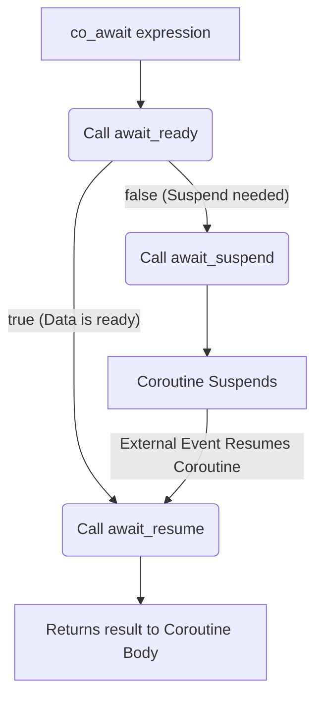

# Coroutines and asynchronous operations

dspsim processes can be C++20 coroutines (`Task<>` registered with `DSPSIM_CORO`) or Python `async def`
coroutines (`Module.add_task`). This document covers the awaitable framework built on top of them:
how a coroutine waits, how modules offer asynchronous operations such as `axis_rx.receive(n, timeout)`,
and how ordinary code (a `main()` or a pytest) drives them with `Context::run_until`.



## Building blocks

There are three kinds of things you can `co_await` / `await`:

| Kind | C++ | Python | What it does |
| --- | --- | --- | --- |
| Leaf wait | `wait(...)` on `Module`/`Context` | `self.wait(...)` / `ctx.wait(...)` | Suspends the **process** until the scheduler wakes it. |
| Task | `Task<T>` coroutine method | any awaitable, incl. bound C++ tasks | Runs a coroutine inline in the awaiting process and yields its value. |
| Entry point | `ctx->run_until(task, timeout)` | `ctx.run_until(task, timeout)` | Runs the simulation until a task completes, from non-coroutine code. |

### Leaf waits

A leaf wait schedules the wakeup in its constructor and suspends the coroutine. All leaf awaitables derive
from `WaitBase`, which records the suspended coroutine as the process's *resume point*, so that nested tasks
resume at the innermost suspension.

| Wait | Resumes when |
| --- | --- |
| `wait()` | any event of the static sensitivity list (`always(...)`) triggers |
| `wait(time_delta)` | `time_delta` time units have elapsed |
| `wait(event)` / `wait({e1, e2})` | the event (any of the events) triggers |
| `wait(event, timeout)` / `wait({e1, e2}, timeout)` | an event triggers **or** `timeout` elapses; returns `WaitResult::Triggered` or `WaitResult::Timeout` |

Semantics that matter when writing modules:

- A suspended coroutine resumes for exactly one reason. Dynamic waits (events, time, event+timeout) disable
  the process's static sensitivity until they complete, and the losing side of an event+timeout is dismissed:
  the process is unsubscribed from the events when the timeout fires, and a pending time wait is dropped if the
  process was resumed first (time events carry the process's `wake_count` at scheduling time).
- A coroutine process that completes (its root task returns or throws) unschedules itself: it is unsubscribed
  from its static and dynamic events and its pending time waits become stale. A one-shot coroutine can
  therefore use `always(...)`, and the scheduler never resumes a completed coroutine.
- Only the scheduler resumes a process: `resume()` and the wake-up callbacks of `ProcessBase` are private,
  with `Context` and `SensitivityEvent` as friends.
- `wait(0)` resumes the process in the next delta cycle, as SystemC's `wait(SC_ZERO_TIME)` does: what the
  processes of the current delta cycle wrote to signals is visible then. `next_trigger(0)` is the same for
  a method process.
- `next_trigger(time)` on a method process is different: it schedules an additional wakeup and never cancels.
  `next_trigger(...)` is only for method processes: in a coroutine process it throws `std::logic_error`.
  `next_trigger(event)` and `next_trigger({e1, e2})` are the method counterparts of `wait(event)` and
  `wait({e1, e2})`.
- Waiting on n events costs n subscriptions and, when one of them triggers, n - 1 removals. Pass a list that
  is built once (`co_await wait(events)`) instead of building a braced list on every wait.
- Build such a list after elaboration (in the process, not in the module's constructor) when it holds
  events of ports: before elaboration, `port.change()` is an event of the port itself, which no signal
  ever triggers.
- `initialize(true)` on a coroutine process that has completed throws `std::logic_error`.
- A timeout of `0` means no timeout. In C++, a literal `0` is ambiguous with the `ProcessBase*` argument, so
  use the overload without a timeout instead.
- Waits take the process to wake from `Context::current_process_`, so they are only valid inside a running
  process (a coroutine body or a task passed to `run_until`).

### Tasks: `Task<T>`

`Task<T>` is the coroutine return type. `Task<>` (void) is a process body; any `Task<T>` can be awaited by
another coroutine of the same process:

```cpp
Task<std::vector<T>> receive(size_t n, uint64_t timeout = 0)
{
    const uint64_t deadline = context()->time() + timeout;
    while (fifo.size() < n)
    {
        if (timeout == 0)
        {
            co_await wait(received_);
        }
        else if (context()->time() >= deadline ||
                 (co_await wait(received_, deadline - context()->time())) == WaitResult::Timeout)
        {
            break;
        }
    }
    co_return take(n);
}
```

- Awaiting a task starts it (symmetric transfer) and resumes the awaiter when it `co_return`s, with its value.
  An exception thrown by a nested task is rethrown in the awaiter; one thrown by a root task propagates out
  of `Context::run()`.
- A task runs in whichever process awaits it. That is what lets `axis_rx.receive()` be awaited from a module's
  coroutine, from a `run_until` task in `main()`, or from a Python coroutine.
- Keep a task alive until it is done. `co_await module.receive(...)` on a temporary is fine: the temporary lives
  for the whole `co_await` expression.
- Awaiting a task is not a function call. Each one creates a coroutine frame (from a per-thread pool of
  freed frames), transfers into it and back, and destroys it: about 150 to 200 instructions even when the
  task finishes without waiting, where a SystemC thread calls an ordinary function. That is nothing next to
  a bus transfer that takes several clock cycles, and it is most of the cost of a task that is called per
  item and rarely waits: in the benchmarks, a fifo whose blocking `put()`/`get()` are tasks runs at a quarter
  of the speed of the same fifo with the test for "full" or "empty" in the calling process
  (`events/fifo`, `coro_task` against `coro_dynamic`). Test the condition in the caller and await only
  when there is something to wait for.

### An awaitable instead of a task

For an operation that usually completes at once and is called often, write an awaitable object instead of
a `Task`. Its `await_ready()` tests whether the operation can proceed, and if it can, the calling coroutine
does not suspend at all: the whole call is inlined into the caller. Only when it cannot does
`await_suspend()` wait, with one of the engine's own waits, which suspends the calling coroutine itself:

```cpp
template <typename T>
class FifoGet
{
public:
    explicit FifoGet(Fifo<T> &fifo) : fifo_(fifo) {}

    bool await_ready() const { return !fifo_.empty(); }
    void await_suspend(std::coroutine_handle<> handle)
    {
        // Subscribes the calling process to the event and records where to resume it.
        fifo_.context()->wait(fifo_.written).await_suspend(handle);
    }
    T await_resume() { return fifo_.pop(); }

private:
    Fifo<T> &fifo_;
};

const T item = co_await FifoGet<T>{fifo};
```

In the benchmarks this is as fast as testing `fifo.empty()` in the calling process, and 4.6 times as fast as
the same operation written as a `Task` (`events/fifo`: `coro_awaitable`, `coro_dynamic`, `coro_task`).
The limit: an awaitable is resumed once, so it cannot wait in a loop. That is enough when one wake-up
guarantees the condition (a fifo with one reader and one writer). When it does not, let the awaitable
report whether it had to wait and loop in the caller, or use a `Task`.

**The general extension point is the task.** To add an asynchronous operation to a module, write a coroutine method
returning `Task<T>` that loops on leaf waits. You should not need to write a new awaiter class; if you do
(a wait on something the scheduler doesn't know about yet), derive from `WaitBase`, schedule the wakeup
through `ProcessBase` in the constructor, and keep `await_suspend()` as inherited.

Modules usually pair the operation with a `SensitivityEvent` member that the module's own process notifies
(`received_.notify()` after pushing to the fifo), so the awaiting task wakes exactly when the state changed
instead of polling the clock. `AxisRx` (`receive`, `received()`) and `AxisTx` (`send`, `drain`, `sent()`)
are the reference implementations.

### Tasks that run on their own: `Context::spawn`

`ctx->spawn(task)` starts a task as a process of its own and lets it go. The context destroys the process
when the task completes, so there is no handle to it and its result is discarded. Use it for work that is
created while the simulation runs, a task per transaction for example (SystemC: `sc_spawn`):

```cpp
Task<> dispatch()
{
    while (true)
    {
        co_await wait(clk.pos());
        context()->spawn(handle_request(request.read()));
    }
}
```

- A spawned task is evaluated in the delta cycle in which it is spawned when a process spawns it, like any
  process that is registered while the simulation runs.
- `register_coro_task()` and `DSPSIM_CORO` are for processes that belong to the design: they return a
  `ProcessBase*` that stays valid for as long as the context lives, also after the task has completed.
- Python: `module.spawn(coroutine)`, next to `module.add_task(coroutine)`.

### Entry point: `Context::run_until`

`run()` advances a fixed amount of time. `run_until` advances event-to-event until a task completes and
returns its value, which is how a non-coroutine `main()` or test uses the awaitables:

```cpp
ctx->elaborate();
axis_rx.ready(1);
axis_tx.push_range(samples);
auto rx = ctx->run_until(axis_rx.receive(samples.size(), /*timeout=*/1000));
```

- The task is registered as a one-shot process, scheduled immediately, and removed afterwards (its static and
  dynamic subscriptions and pending time events are cleaned up), so `run_until` can be called repeatedly and mixed
  with `run()`.
- `run_until(task, timeout)` throws `dspsim::TimeoutError` if the task is not done after `timeout` time
  units, with the simulation left at the deadline. `timeout == 0` disables it; with a free-running clock and a
  task that never completes, that runs forever, so prefer a timeout.
- It throws `std::runtime_error` if the simulation stalls (no pending time events) before the task completes.
- `run_until(event, timeout)` is the simple case: `true` if the event triggered, `false` on timeout.
- Inside a coroutine there is no need for `run_until`: `co_await wait(event, timeout)` is the equivalent.

## Python

Python coroutines are driven by `PyTask` processes; Python's own `await` handles nesting. Everything above
is available with the same names:

```python
with Context() as ctx:
    with ctx.construct():
        clk = Clock("clk", 10)
        tx, rx = AxisTxS32("tx"), AxisRxS32("rx")
        ...

    async def main():
        rx.ready = 1
        assert await tx.send([1, 2, 3, 4], timeout=1000)
        return await rx.receive(4, timeout=1000)

    data = ctx.run_until(main(), timeout=10_000)  # -> [1, 2, 3, 4]
    data = ctx.run_until(rx.receive(4, timeout=1000))  # a C++ task directly
    ok = ctx.run_until(rx.received, timeout=100)  # an event
```

- `await self.wait(event, timeout=100)` returns `WaitResult.Triggered` or `WaitResult.Timeout`.
- A `run_until` timeout raises the builtin `TimeoutError`.
- `SensitivityEvent(ctx)` creates an event of your own, and `event.notify()` raises it: the tasks and
  processes waiting on it run in the next delta cycle. The context owns the event.
- Bound C++ tasks (`Task`, `TaskBool`, `TaskListS32`, ...) are awaitable objects. They must be awaited from a
  task running in the simulation (`Module.add_task` or `Context.run_until`), never from `asyncio`.

### Exposing a C++ task to Python

Bindings wrap a `Task<T>` with `py_task(context, task)` and need a `bind_task<T>(m, "TaskName",
"python result type")` registration once per result type `T` (see `src/bindings/engine.cpp`). Both are
in [`<dspsim/bindings/task.h>`](../src/include/dspsim/bindings/task.h), which is installed with the
dspsim headers so that the extension modules of models can bind their own tasks:

```cpp
.def("receive", [](AxisRx<T> &self, size_t n, uint64_t timeout)
     { return py_task(self.context(), self.receive(n, timeout)); },
     nb::arg("n"), nb::arg("timeout") = 0)
```

`PyTaskAwaitable<T>` implements `__await__` as a Python generator: it starts the C++ task (which suspends on
its first leaf wait and records the process's resume point), yields to the scheduler, and steps the C++ task
from the resume point each time the Python coroutine is resumed, until it is done.

`PyTaskAwaitable<T>` is a class template in that header, so every extension module that returns one
compiles its own copy, but it is one C++ type and has one Python class per process: nanobind finds the
class by the C++ type, across the extension modules of the `dspsim` domain. A model's extension that
returns a `Task<bool>` therefore returns the framework's `TaskBool`, and must not bind it again. For a
result type that the framework does not bind, an extension calls `bind_task_once<T>(m, "name")`, which
binds the awaitable unless a module loaded before already has. The C++ module builder
([CppBuilder.md](CppBuilder.md)) generates exactly this for methods that return a `Task<T>`.

## Caveats

- Don't destroy a `Task<T>` that is suspended inside the scheduler (e.g. by dropping it before it is done),
  and don't await the same task twice.
- `Wait*` objects schedule their wakeup on construction: construct one only to await it immediately.
